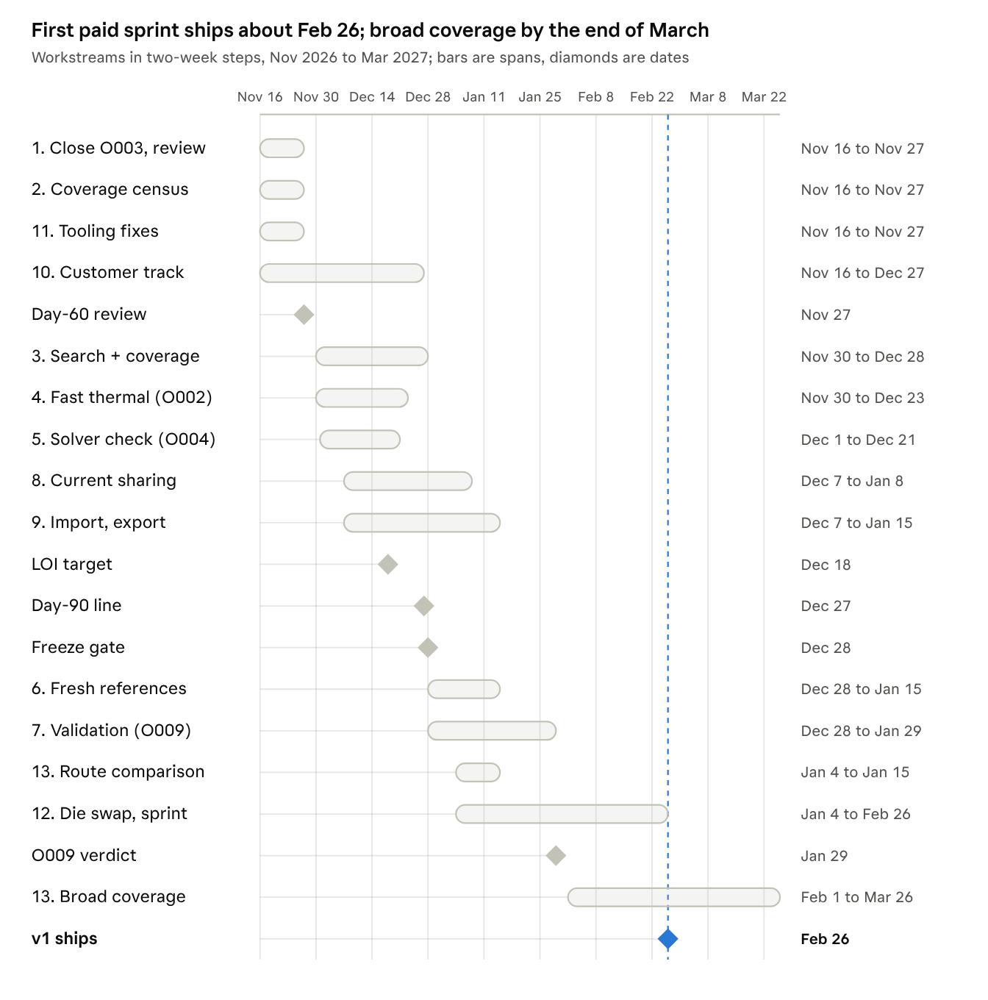

# Commutate plan and timeline

Nov 15, 2026 · @Lucas

> Snapshot of the living Claude Doc "Commutate Plan and Timeline" (https://claude.ai/artifact/FEGt6mrR4zoLEXmvNg9cYk), exported 2026-11-15 (doc revision 53). The doc is the working copy: edit it there and re-export to update this file. Dates without a year are 2026-27.

Commutate keeps the re-layout direction and spends the next ten weeks building what E010 and the reference screening showed is missing: coverage of the layout features real modules use, a search that starts from the reference layout and can beat it, and a fast thermal model. Re-layout gains are tested on fresh references by about the end of January 2027. The first product, a paid re-layout sprint that Commutate runs on a partner's module with their new dies, ships about 02-26, and coverage of most half-bridge SiC modules follows by the end of March. The day-60 review on Nov 27, 2026 closes O003 with no verdict, and the day-90 line on Dec 27, 2026 (a paid or LOI-backed sprint) runs on the customer track in parallel.

## Starting point

The physics and the run pipeline work; the search, and the narrow range of layouts it can represent, are the gap. The reference screening (D0019) found almost no public module that fits the generator. E010 ran end to end with every physics check passing, but its planted-headroom control showed the search cannot reach a real designer's layout on 2D\_Case\_2R.

| Capability | Status | Evidence |
| --- | --- | --- |
| Fast inductance model (L1 PEEC) | Ranks layouts well enough to drive search; pairs under 5 % apart are misordered 23-38 % of the time | O001 PASS, claim C002 |
| Inductance reference (l2\_layout, 0.25 mm cells) | In use; accuracy on real module geometry not yet checked | O004 drafted |
| Thermal reference (scikit-fem) | Matches converged analytic solutions and the in-house finite-volume solver | O007 PASS, claim C004 |
| Fast thermal model | Does not exist; thermal is checked on at most 8 candidates per reference | O002 drafted |
| Search (generator, L1 screen, L2 shortlist) | Cannot draw the reference's own layout on 2R; best draws 3-6 % above it | E010, diagnosis T0349 |
| Layout coverage (generator family) | One substrate; per switch, one straight row of identical dies in one orientation; four stacked copper bands. Not representable: quarter-turned dies (2D\_Case\_5), side-by-side switch blocks (2D\_Case\_6), dies in several rows, copper rings, separate diode dies, six-packs | D0019, T0314 |
| Layout input | Each reference needs its own hand-written reconstruction script | T0263 |
| Thermal yardstick (Tj max with grid estimate) | Cannot certify +2 K on 2R: the hot spot moves between grid levels | D0020 |
| Burst VM pipeline | Ran E010 in 6.2 VM-hours for about $11 | run E010-20261114T202413-80c1 |
| Orchestrator (mfos) | Five loop defects fixed on 11-14; four small fixes open (section 11) | commit 721e9ed6 |

O003 stands with INVALID evidence and no verdict: the control recovered 16.1 % of the 22.0 % planted, against 20.7 % required. Its single evaluation is unused, its replans are used up, and $6.77 of its $264.99 cap is left. All objectives together have spent about $815 so far.

## First product: what ships, and when

The first product is a paid derivative re-layout sprint that Commutate runs for a design partner. It ships about 02-26 on the module features covered by then, and coverage widens behind it, not ahead of it.

|  | v1: first paid sprint | v2: broad coverage |
| --- | --- | --- |
| Ships | About 02-26 | About 03-26 |
| The customer gets | 3-5 ranked re-layouts for their new dies in their existing housing, each with L2 loop inductance, die-average Tj and current sharing with uncertainty bands, a DRC report, and Q3D and Icepak files to verify in their own flow | The same, for at least 80 % of census half-bridge modules; six-packs next |
| Modules covered | Wire-bonded half-bridges on one substrate, with the features O008 adds: quarter-turned dies, side-by-side blocks, and whatever the partner's module needs | Adds the census-ranked features (section 13) |
| Gate to ship | O008, O002 and O004 pass; O009 has a verdict; the partner's module passes the coverage screen; die swap passes its control (section 12) | O010 passes |
| What we claim | Measured numbers on the partner's module, which they verify; a general headroom claim only if O009 passes | As v1, across modules |

How the plan balances speed and coverage:

- **Coverage follows customers.** Each extension is built when a committed partner's module needs it; the census orders the rest.
- **Speed levers.** Current sharing is reported, not gated, in O009; die swap and the sprint pipeline are built on a branch while O009 runs; the representation choice is made in January, not February.
- **What is not traded away.** Every capability passes a planted-headroom control before a customer sees its output, and every judged run uses frozen code.

## Timeline

Sections 1, 2 and 11 finish by the day-60 review. Sections 3 to 5, 8 and 9 build in parallel up to the 12-28 freeze. Fresh references load only after it and validation runs in January, while die swap is built on a branch. The first paid sprint ships about 02-26, and broad coverage runs through March.

## 1. Close O003 and prepare the day-60 review

O003 ends with no verdict, recorded honestly, and the day-60 review sets the next direction. Window: 11-16 to 11-27. Cost: near zero (founder session work).

**What.** Record E010 as "the frozen search does not reach the 2R designer's level": no verdict, and E010's h = 0 is not evidence of no headroom. Park O003 and bring the finding and this plan to the thesis review.

**Why.** O003's frozen rules decide its outcome, and a clean record keeps the falsification program credible. Its single evaluation stays unused because INVALID evidence is not counted. The review must also decide whether to amend O003's pre-written rule, which says to test the current-mismatch half of A-T3 before any more inductance work.

**How.**

1. Approve I0203 (merge diagnosis T0349) with `--no-replan`.
2. Accept decision record D0023, drafted by the session: E010 void, the finding, and the design rule from T0349 (rehearse a planted-headroom control on a development reference whose twin the sampler cannot draw).
3. Pause O003 (`mfos objective pause O003`) so the loop spends nothing more on it.
4. Thesis review on 11-27: set A-T3 to "untested, instrument insufficient", decide the order of work (sections 2 and 3 before current-sharing work, with the reason recorded), set the coverage target (section 2), and set budgets.
5. Add the T0349 design rule to project memory so every later control is rehearsed this way.

**Done when.** D0023 is committed and the thesis review is recorded in the charter.

## 2. Coverage census and screening of candidate references

A fact-only survey of real SiC half-bridge modules decides which layout features to support first, and which candidates the January validation can use. Window: 11-16 to 11-27. Cost: about $10-20 agent.

**What.**

- A census of 15-20 commercial and public wire-bonded SiC half-bridge modules, from datasheets, application notes, published teardowns and PowerSynth samples. Each is answered on T0314's 14 screening questions, plus five more: substrates per module, die array (rows by columns), die rotation, separate diode dies, terminal pads per net.
- The same screen on the January candidates (NC State PREES and any customer layout), from answers about the module, never its geometry.
- A coverage table: how many census modules each missing feature blocks, with a target of at least 80 % representable by the end of March (section 13).

**Why.**

- "Most half-bridge SiC modules" has to be a number, or coverage work never ends. Each generator extension costs about 200-350 changed lines and a week (T0314's estimate for side-by-side blocks), so extensions are ordered by how many real modules they unlock.
- The January candidates must be screened before the freeze, so the extensions they need are built in time (section 3).

**How.**

1. Scout task: collect the census from public sources, cited, facts only. No geometry enters the repository, as with D0019's screens.
2. Founder: send the screening questions to PREES and to customer contacts.
3. Session: turn the answers into a ranked feature list for O008 (section 3) and the coverage objective (section 13). A module whose facts are known but whose geometry is unseen can still be judged later, with that declared (as D0019 did).

**Done when.** The census and the candidates' screens are recorded, and the missing features are ranked by modules unlocked.

## 3. A search that starts from the reference and beats it, on the features real modules use

The critical path: without it no headroom claim can be made, and most real modules cannot even be represented. New objective (working id O008), development geometry only. Window: 11-30 to 12-28. Cost: about $140-220 agent, $10-25 VM.

**What.**

- Reach: a parameterisation that contains the reference's own layout (its twin). Today every slot is attached to its column's inner edge, so the twin cannot be drawn.
- Quarter-turned dies: per-die rotation in 90-degree steps, in the generator, the twin and the reconstruction (today only 0 or 180 degrees).
- Side-by-side switch blocks: each switch's die and landing bands in their own region, wires in either direction, as in 2D\_Case\_6.
- Any further feature the January candidates or the first partner's module need, from the screen (section 2), for example dies in two rows.
- A local search seeded at the twin, beside the random screen: DRC-valid moves of slot extents, die positions and rotations, and wire landings, screened by L1 and confirmed by l2\_layout.
- A planted-headroom control that must pass on every development layout, at least one per extension: a copy of the twin at least 25 % worse in inductance, from which the search must recover the planted headroom.

**Why.** E010 (diagnosis T0349) showed the random search cannot reach the 2R designer: the twin is outside its reach and its best draws sit 3-6 % above it. The screening (D0019, T0314) showed the family cannot represent 2D\_Case\_5 or 2D\_Case\_6 at all, so no clean public reference exists today. Starting from the reference is also the product: a derivative re-layout begins from the customer's layout.

**How.**

1. Session drafts O008 (hypothesis, criteria, kill line, and the extension list from section 2); the founder edits and approves it.
2. Builder tasks, one per extension, in `generate/derivative.py` and `generate/twin.py`: reach, quarter turns, side-by-side blocks. Each has a test that a reference with that feature lies in the new space. Development streams are re-baselined in the open where they change.
3. Builder task: a local search in `optimize/` (pattern search or a small evolution strategy, DRC as a hard constraint, sealed seeds), scored so thermal and current-sharing terms can be added later.
4. Scientist task: a pre-registered development-only experiment (E011) running the control on gen2\_0, 2D\_Case\_4, 2D\_Case\_2R and 2D\_Case\_6 (both now development geometry), and on synthetic housings with quarter-turned dies.
5. Review, register, run, evaluate.

**Done when.** The control passes on every development layout, every extension included. Then the generator, twin, search and degradation rule are frozen (code hashes recorded) before any judged reference is loaded.

## 4. Fast thermal model (O002) and the thermal yardstick

A thermal model fast enough to sit inside the search, and a temperature measure that converges, so the search can improve Tj instead of only checking it. Window: 11-30 to 12-23, in parallel with section 3. Cost: O002's budget, $120 ($108 left).

**What.**

- An L1 thermal model that predicts each die's junction temperature, and the spread across paralleled dies, in seconds per layout. Candidates: a calibrated coarse-grid solve, or superposition of precomputed per-housing responses. O002's design picks one.
- A yardstick decision: the temperature quantity the +2 K limit is judged on, settled before any registration.

**Why.**

- Today's thermal solvers are accurate but slow: about 15 minutes per layout at the middle grid and hours at the finest. So E010 checked Tj on at most 8 candidates per reference, after optimising inductance alone. A search that cannot see Tj cannot find layouts that improve both.
- O003's rule (hottest node at three grid levels, with a grid-error estimate) cannot certify +2 K on real dies. The hot spot moves between grid levels, so the estimate is infinite (D0020). The die-average temperature, the quantity datasheet thermal resistances refer to, is already computed and reported, and it converges.

**How.**

1. Founder decides the yardstick at or just after the thesis review. Recommended: die-average Tj gated, hottest-node Tj reported.
2. Session revises the O002 draft: model choice, criteria in the chosen yardstick (ranking and layout-to-layout differences against the scikit-fem reference, claim C004), and a new experiment id.
3. Scientist and builder tasks: implement the model in `src/moduleforge/thermal/`, tested against analytic limits, symmetry and power scaling.
4. A pre-registered experiment on generated layouts compares L1 with the reference at the operating point.
5. Wire the model into the search's score (section 3) once O002 passes.

**Done when.** O002 passes and the search optimises inductance and die-average Tj together.

## 5. Inductance solver accuracy on real modules (O004)

An independent check that our inductance reference is right on real module geometry, so inductance gains stop being provisional. Window: 12-01 to 12-21, in parallel. Cost: O004's budget, $100 ($90 left), plus about $15-30 VM.

**What.** Compare `solvers.l2_layout` with the pinned FastHenry build (D0002), run as a separate program on the identical exported geometry. The check covers the commutation loop of the reconstructed public modules (D0007), dies as shorts, at 10 and 20 MHz: within 3 % in loop inductance, and tighter on the re-layout-to-reference ratio that headroom is built from.

**Why.** Every headroom figure is a ratio judged by l2\_layout. Until an independent field solver agrees on real modules, a PASS stays provisional (O003's decision rule). Customers will verify in their own Q3D flow (A-T4), so our numbers have to agree with an independent solver first.

**How.**

1. Session brings the O004 draft up to date (references already loaded: 2D\_Case\_2R, 2D\_Case\_6, 2D\_Case\_4), and the founder approves it.
2. Scientist task: design E004 (geometry export to FastHenry, refinement levels, the pass rule for the ratio); critic review; founder registers.
3. Run on a burst VM (about 260 vCPU-hours planned) with the same launcher pattern as E010.
4. The loop evaluates; claim recorded if it passes.

**Done when.** O004 passes. If it fails, the discrepancy is diagnosed before any validation run uses l2\_layout as judge.

## 6. Fresh judged references, screened first, loaded only after the freeze

At least two real modules the search has never seen, each screened first so the generator can represent it. Window: screening now; loading only after the freeze (about 12-28). Cost: about $10-20 agent.

**What.** Two or more wire-bonded half-bridge modules that pass the coverage screen (section 2). The candidates:

- customer reference layouts under NDA;
- an NC State PREES half-bridge with open files, if one exists (the screened CCS050M12CM2 is a six-pack with diode dies, which waits for section 13);
- PowerSynth 2D\_Case\_5, once quarter-turned dies are supported. Its facts are known but its geometry is unseen, so using it is declared, as D0019 recorded.

**Why.**

- 2D\_Case\_2R is no longer clean (the generator was changed twice because of it), and 2D\_Case\_6 is now development geometry.
- One counted reference sends any PASS to founder review (D0017).
- Customer layouts turn an "indicative" public result (D0010) into evidence a customer can act on.
- The screening showed that the current generator excludes most candidates, so screening comes before anything else.

**How.**

1. Screen every candidate before the freeze (section 2) and add the extensions they need to O008 (section 3).
2. Founder pursues PREES access and customer NDA layouts, recorded in `project/customers/` per its README. Either the NDA allows cloud VMs and AI-agent processing, or the partner's geometry goes through the sealed path (section 9): only deterministic code reads it, and agents see metrics, never geometry.
3. No one opens new geometry until the generator, twin, search and thermal model are frozen with code hashes recorded. The validation objective states this as its leakage rule.
4. After the freeze: import each module (section 9) or reconstruct it with a frozen script, measure its own design rules, and check admissibility.
5. A generator/DRC-only feasibility check on each before registration: the twin is reachable and DRC-valid candidates are drawn.

**Done when.** Two or more admissible references are loaded after the freeze, with their files hashed.

## 7. Validation objective: electrical and thermal headroom on fresh references

The payoff: a recorded verdict on whether re-layout improves a real module's electrical and thermal performance inside its own housing. Working id O009, the successor of O003. Window: design 12-28 to 01-15, run 01-18 to 01-22, verdict about 01-25 to 01-29. Cost: about $80-120 agent and $20-45 VM per run.

**What.** On the fresh references (section 6), a re-layout from the frozen search keeps each housing's outline, terminals, stack, dies and bond-wire count. Criteria, keeping O003's lines:

- Pass: commutation-loop inductance at least 20 % lower at the conservative end of its band, at most +2 K die-average Tj, on every counted reference.
- Kill: inductance-only headroom below 10 % on every counted reference whose search has levelled off.
- Reported, not gated: current-mismatch headroom against the charter's 50 % line (section 8). Gating it waits until the metric is validated, so it cannot delay the verdict.
- Gate: the planted-headroom control passes on every reference, now reachable by construction (section 3).

**Why.** This is the product claim (A-T3) and the question O003 asked. With a search that reaches the designer, layouts the generator can represent, a converging thermal measure and a checked solver, the verdict means something either way. A PASS supports selling re-layouts; a FAIL is a real kill signal.

**How.**

1. Session drafts O009 once O008 and O002 have passed; the founder edits and approves it, which freezes it.
2. Scientist task: design the experiment (E012) from E010's runner, with the new search, L1 thermal in the score, the die-average yardstick, the current-sharing metric and the fresh references. Development rows come from development geometry only.
3. Critic review, founder registration, then one burst VM run with the shared launcher (section 11).
4. The loop evaluates once, and the thesis review takes the verdict.

**Done when.** O009 has a recorded verdict, and the charter's A-T3 status is updated from it.

## 8. Current sharing, then gate-loop symmetry

Current sharing is reported in the validation and in every sprint, and becomes a gated criterion (A-T3's second branch) once validated; gate-loop symmetry follows in its own objective after O009. Window: 12-07 to 01-08. Cost: about $30-50 agent.

**What.**

- Current sharing: how unevenly paralleled dies carry current while switching. It is computed from each die's own commutation path (partial inductance and resistance from DC+ through its wires to DC-), with headroom = 1 - mismatch(re-layout) / mismatch(reference) and the charter's 50 % line.
- Gate-loop symmetry: the spread of gate-loop inductance across dies. Today gate and Kelvin copper are fixed keep-out areas, so optimising them needs a later change to the generator and design rules.

**Why.** The thesis promises better current sharing and gate-loop symmetry, and A-T3 holds if either branch clears its line. O003's rule also asked for current mismatch next. It reuses the inductance solver, so it costs little and widens what a re-layout can win: uneven sharing concentrates heat and switching stress in one die.

**How.**

1. Scientist task: define the metric and check it against a double-pulse circuit simulation (ngspice, the L2 circuit reference) on two or three development layouts.
2. Builder task: per-die path extraction in `solvers.l2_layout` (dies modelled one by one instead of as one short) and a current-sharing term in the search score.
3. Reported in O008's development experiment and in O009; gated in a later objective once the double-pulse check passes.
4. After O009: a gate-loop objective that makes gate copper movable, with its own twin and DRC changes.

**Done when.** The metric is validated on development layouts and is part of O009's registered design.

## 9. Import, export and a sealed path for customer layouts

Read a customer's layout file directly, hand back files their own tools open, and keep their geometry away from AI agents when the NDA requires it. Window: 12-07 to 01-15. Cost: about $50-80 agent.

**What.**

- Import: read a reference layout from the formats customers use into the layout model (copper per net, dies with pads and rotation, wire bonds, terminals, keep-outs), then measure its design rules automatically with the existing `measure_rules`.
- Export: write a layout, with its stack and materials, as geometry that Q3D and Icepak open. These are the customer-runnable verification decks the thesis promises.
- Sealed path: customer files live outside the repository and are read only by deterministic code (importer, solvers, search, exporter) on compute the partner approves. Agents see metrics and reports, never geometry, as the sealed holdout data is handled today.

**Why.**

- Every reference so far needed its own hand-written reconstruction script (T0263 for 2R and 2D\_Case\_6). That cannot scale to most modules, and hand reconstruction is where errors creep in.
- Customers verify in their own tools (A-T4). A layout they cannot open in Q3D or Icepak cannot be verified, so it cannot be sold.
- Many NDAs will not allow AI processing. Without a sealed path, those partners cannot be served at all.

**How.**

1. Founder asks design partners which formats they use (for example DXF or STEP exports from their CAD, or Q3D and Icepak projects); only those are built.
2. Builder task: an importer in `src/moduleforge/io/` (new), tested by round trip (a generated layout exported, imported and fingerprint-identical) and on the reconstructed public modules.
3. Builder task: an exporter for Q3D and Icepak geometry, checked by re-solving one exported module with our own solvers and by a partner opening it in their tools.
4. Founder session (policy and tooling are protected): a sealed-input location that the role write and read scopes deny to every agent, and a sprint command that runs end to end on it and writes only metrics and the report where agents can read.
5. The fresh references (section 6) come in through the importer where their format allows; otherwise through a frozen reconstruction script, as before.

**Done when.** A partner's format imports with its rules measured, an exported layout opens in the partner's Q3D and Icepak, and a sealed run produces a report with no geometry readable by agents.

## 10. Customer track and the day-90 criterion

The charter's day-90 line is commercial: no paid or LOI-backed sprint by 12-27 triggers a kill review, whatever the physics shows. Validation lands at the end of January, so this track runs in parallel and cannot wait for it. Window: now to 12-27, aiming for a signed LOI by 12-18, before the holidays. Cost: founder time, plus about $10-30 agent.

**What.** A design-partner sprint on a real derivative problem (a new die generation, a second source or a new die count inside an existing housing), backed by an LOI or payment. Alongside it, the evidence A-T4 needs: customers accept software-generated layouts that they verify in their own Q3D and Icepak flow.

**Why.**

- It is a kill criterion on its own, independent of O009.
- A design partner is the best source of NDA reference layouts (section 6), of the file formats to import (section 9), and of the exact derivative problem to solve first. Its module sets what v1 must cover (section 12).

**How.**

1. Founder approaches module makers and OEMs with a sprint offer on one derivative problem, scoped to a few weeks. The partner's reference layout comes under an NDA; if it does not allow AI processing, the layout goes through the sealed path (section 9). The coverage screen (section 2) is the first conversation.
2. Session drafts a two-page capability brief from recorded claims only: C002, C004, and O004 once it passes. It makes no headroom claim before O009.
3. The partner names its CAD and simulation formats, which set the importer and exporter in section 9.
4. Every conversation is recorded in `project/customers/`, tagged with its assumption id (charter rule).

**Done when.** A paid or LOI-backed sprint is recorded by 12-27. If none is, the day-90 review happens as the charter says.

## 11. Tooling fixes in mfos

Four small fixes before the new objectives start, so a good run cannot be ruled INVALID for bookkeeping reasons. Window: 11-16 to 11-27. Cost: founder-session time; agents cannot write `tools/`.

**What.**

1. Artifacts: runners register a bare artifact name while writing the file under `<run>/work/`, and the stored copy stays on the VM. Runners should register run-directory paths, and the launcher should fetch the artifact store.
2. One diagnosis per failure: E010's failed run spawned two diagnoses of the same event (T0348 and T0349, $5 budget each).
3. The guard hook reads `from mfos import models` as the `mfos import` command and blocks agents' registration dry runs.
4. One parameterised burst launcher, committed executable, in place of a copy per experiment (e008\_dev, e010\_dev).

**Why.** Each one cost money or a run on 11-14 and 11-15. The artifact gap alone would have made even a valid E010 inadmissible, and the next objectives all run through the same launcher and evaluator.

**How.**

1. Founder session makes each change with a test in `tests/mfos` that fails before and passes after, as on 11-14. The full mfos suite and the fast gate run before the merge.
2. The founder merges and restarts the loop while no task is in verify.
3. The session also adds a pre-flight checklist for new task briefs: role write scope, free experiment id, and no check that depends on a later step. All three failures on 11-14 came from briefs.

**Done when.** The four fixes are on main, each with its test, and the loop is restarted on them.

## 12. First paid sprint (v1): new dies and delivery

The product itself: take a partner's reference layout and their new dies, and deliver re-layouts they can verify. Window: die swap on a branch from 01-04, merged after O009's run (01-22); first sprint 01-25 to 02-26. Cost: about $60-100 agent, $10-25 VM per sprint.

**What.**

- Die swap: a re-layout whose dies differ from the reference's (footprint, pad map, a second source, or one more or one fewer die per switch). It is seeded from the reference by placing the new dies in its die slots and adapting copper and wires, then improved by the local search.
- A sprint pipeline as one command: import (section 9), coverage screen, die swap, search with inductance, thermal and current-sharing terms, L2 checks of the shortlist, export, and a short report giving each number with its uncertainty band.
- The first paid sprint, delivered to the design partner.

**Why.** Every test so far keeps the reference's own dies, but the product's job is a new die in an old housing (the charter's thesis). Without die swap there is nothing to sell. Building it on a branch while O009 runs keeps O009's frozen code intact and costs no calendar time.

**How.**

1. Builder task, on a branch from 01-04: die swap in the generator and twin, tested on 2-3 development layouts with real die changes (a larger die, a second source, one more die per switch). Merged after 01-22.
2. Scientist task: a planted-headroom control under die swap on development geometry, so the sprint's search is shown to work with new dies before a customer sees its output.
3. Builder task: the sprint pipeline and its report template, runnable on the sealed path.
4. Founder runs the first sprint with the partner; the partner verifies in their own tools, and that verification is recorded in `project/customers/` as A-T4 evidence.

**Done when.** The first sprint is delivered and the partner's verification is recorded.

## 13. Coverage of most half-bridge SiC modules, then six-packs (February-March)

After v1 ships, widen what Commutate can re-lay out until it represents at least 80 % of the census modules, then extend to six-packs. A committed partner's module jumps the queue. Window: route comparison 01-04 to 01-15, coverage work 02-01 to 03-26. Cost: about $100-150 agent and $10-30 VM.

**What.**

- The remaining census features, in the ranked order from section 2. Likely candidates: dies in several rows per switch, separate antiparallel diode dies, several substrates in one module, several terminal pads per net, copper rings and extra strips, and dies off the 0.5 mm grid.
- A representation choice, made in January: keep adding parametric families, or switch to a reference-native representation. In the second, the search edits the imported reference's own copper, dies and wires directly, so the reference is exact (no twin to construct) and a new feature needs no new family.
- Six-pack modules (three legs sharing DC+ and DC-), which the thesis names, once half-bridge coverage is met.

**Why.** "Most half-bridge SiC modules" is the product's reach, and the census makes it a number. Each parametric extension costs about a week, so beyond a handful the reference-native route is likely cheaper. It also removes the twin construction, the source of 2D\_Case\_6's and 2R's failures. Deciding the route in January means February is not spent on families that would be replaced.

**How.**

1. Scientist task, 01-04 to 01-15, on development geometry only (no frozen file touched): compare the two routes on cost per feature and planted-control pass rate. The founder decides by 01-20.
2. Session drafts the coverage objective (working id O010) with the census as its scope. It passes when at least 80 % of census modules are representable and the planted-headroom control passes on a development set covering each added feature.
3. Builder tasks per feature, or for the new representation, each with its own control, with layouts coming in through the importer (section 9). A waiting partner's module goes first.
4. Then a six-pack objective with the same pattern: census, coverage, control, validation on a fresh six-pack.

**Done when.** At least 80 % of the census is representable, the control passes on every added feature, and the six-pack objective is drafted.

## Budget

Through the January verdict the plan needs about $550-770 of agent spend and $45-110 of VM time. The first sprint and broad coverage in February and March add about $160-250 and $20-55. Budgets are set objective by objective at the thesis review. Estimates are scaled from past spend: O001 $288, O003 $256 (with heavy rework), O007 $93.

| Workstream | Objective | Agent USD (est.) | VM USD (est.) | Window |
| --- | --- | --- | --- | --- |
| 1. Close O003 | O003 | 0 | 0 | 11-16 to 11-27 |
| 2. Coverage census | in O008 | 10-20 | 0 | 11-16 to 11-27 |
| 11. Tooling fixes | none (session) | 0 | 0 | 11-16 to 11-27 |
| 3. Search and coverage extensions | O008 (new) | 140-220 | 10-25 | 11-30 to 12-28 |
| 4. Fast thermal model | O002 | 108 (left of 120) | 0-10 | 11-30 to 12-23 |
| 5. Solver accuracy | O004 | 90 (left of 100) | 15-30 | 12-01 to 12-21 |
| 8. Current sharing (reported) | in O008 and O009 | 30-50 | 0 | 12-07 to 01-08 |
| 9. Import, export, sealed path | in O009 | 50-80 | 0 | 12-07 to 01-15 |
| 6. Fresh references | in O009 | 10-20 | 0 | 12-28 to 01-15 |
| 7. Validation | O009 (new) | 80-120 | 20-45 | 12-28 to 01-29 |
| 13. Route comparison | in O010 | 20-30 | 0 | 01-04 to 01-15 |
| 10. Customer track | none | 10-30 | 0 | now to 12-27 |
| 12. First paid sprint (v1) | product tasks | 60-100 | 10-25 | 01-04 to 02-26 |
| 13. Broad coverage, then six-packs | O010 (new) | 100-150 | 10-30 | 02-01 to 03-26 |

The policy's daily cap of $120 is not binding. Pace is set by founder approvals (merges, registrations, VM launches), so a quick turnaround on inbox items keeps the dates.

## Decisions for the founder

Fourteen decisions, five of them at the thesis review; the first two are due now.

| Decision | Needed by | Recommendation |
| --- | --- | --- |
| Approve I0203 (merge diagnosis T0349) | Nov 16, 2026 | Approve with `--no-replan` |
| Go ahead with the coverage census and the candidates' screens | Nov 16, 2026 | Start now |
| Accept D0023: E010 void, no verdict, T0349's design rule | Nov 20, 2026 | Accept |
| Order of work: coverage and the search before current-mismatch work (amends O003's rule) | Nov 27, 2026 | Amend, with the reason recorded |
| Thermal yardstick for +2 K | Nov 27, 2026 | Die-average Tj gated, hottest node reported |
| The first product: a paid sprint (v1) with the ship gate in "First product" | Nov 27, 2026 | Accept |
| Coverage target: at least 80 % of census modules by the end of March, following customers first; six-packs after | Nov 27, 2026 | Accept |
| Budgets for O008, O002, O004 and O009 | Nov 27, 2026 | About $550-770 agent through January |
| Approve O008 (with its extension list) and the refreshed O002 and O004 drafts | Nov 30, 2026 | Approve after editing the session's drafts |
| Data access and file formats: PREES and partner layouts; the sealed path where an NDA forbids AI processing | Dec 14, 2026 | Start the requests this week |
| Signed LOI with a design partner, ahead of the holidays and the day-90 line | Dec 18, 2026 | Start talks now |
| Approve O009, the validation objective, with current sharing reported, not gated | Dec 28, 2026 | Approve once O008 and O002 have passed |
| Representation route for broad coverage: parametric families or reference-native | Jan 20, 2027 | Decide on the January comparison (section 13) |
| Merge die swap into main | Jan 22, 2027 | Only after O009's run has finished, so its frozen code stays intact |

## Risks and stop lines

The biggest risks are that the new search still cannot pass its control, and that real modules need more features than a few extensions can add. In both cases the plan stops and returns to the founder rather than spending through it, and nothing reaches a customer before its control passes.

| Risk | Early sign | Response or stop line |
| --- | --- | --- |
| The search still cannot recover planted headroom | O008's control fails on a development layout by 12-28 | One diagnosis and one redesign; a second failure stops inductance-search work and goes to the founder |
| Real modules need many separate extensions | The census shows fewer than half of modules representable even after O008's extensions | Choose the reference-native route on 01-20 and start it at once |
| The partner's module needs a feature v1 does not cover | Its screen shows the gap in December | Build it in January if it takes a week or less; otherwise run the first sprint on a covered module or slip v1 |
| A January candidate needs a feature not built by the freeze | Its screen shows the gap after 12-07 | Build it if it takes a week or less; otherwise that candidate waits for February |
| O009 does not pass | Verdict INCONCLUSIVE or FAIL around 01-29 | INCONCLUSIVE: the sprint goes ahead, sold without a general headroom claim. FAIL: thesis review before any sprint delivery |
| Die swap cannot pass its planted control | The control fails on a development die change in January | v1 slips; no sprint output reaches a customer until it passes |
| L1 thermal cannot resolve layout differences well below 2 K | O002 fails its ranking or difference criterion | Keep thermal as an L2 check on a shortlist; the search then optimises inductance under a thermal check, more slowly |
| l2\_layout disagrees with FastHenry on real modules | O004 fails | No validation run or sprint until the discrepancy is diagnosed and fixed |
| No fresh references by 12-28 | PREES or NDA access still open in mid-December | Validation slips; 2R and the development layouts are never reused as judged references |
| Fresh geometry seen before the freeze | Any read of it before the code hashes are recorded | That reference is void for judging |
| No signed LOI by 12-18 | No partner in active talks by early December | Day-90 kill review on 12-27, as the charter says |
| Holidays and approval delays | Inbox items open more than a day | Dates slip week for week; scope does not grow to compensate |
